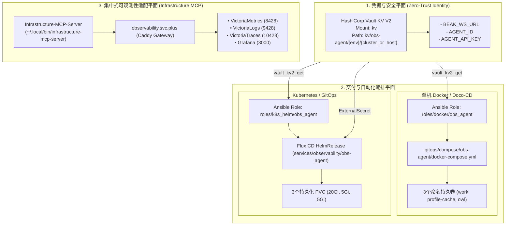

# 观测云 Agent (obs-agent) 与集中式可观测性工程交付白皮书

> **文档版本**: `v1.0.0`
> **更新时间**: 2026-10-28
> **归档位置**: `playbooks/docs/obs-agent-and-observability-delivery-whitepaper.md`
> **涉及仓库**: `ai-workspace-infra/playbooks`, `ai-workspace-infra/gitops`, `ai-workspace-infra/Infrastructure-MCP-Server`

---

## 一、架构愿景与体系总览

本白皮书规范了观测云原生容器化代理 **`obs-agent`** 在私有化、轻量级边缘环境及 Kubernetes 集群中的标准交付链路，结合 **HashiCorp Vault** 统一凭据中枢与 **Infrastructure-MCP-Server** 集中式可观测性协议网关，实现从**单机 Docker (Doco-CD)** 到 **Kubernetes (Flux CD)** 的全声明式、零信任安全交付。



---

## 二、关键技术标准与基线规范

### 1. 运行时与容器安全加固
遵循 CIS Docker & Kubernetes Hardening 基线：
- **执行用户**：强制以非 root 用户执行（`--user 10001:10001` / `runAsUser: 10001`）。
- **特权消除**：严格剥离所有系统 Capability（`--cap-drop ALL` / `capabilities.drop: [ALL]`）。
- **提权防护**：禁止运行期权限提升（`--security-opt no-new-privileges=true` / `allowPrivilegeEscalation: false`）。
- **系统调用防护**：Kubernetes 工作负载必须显式声明 `seccompProfile.type: RuntimeDefault`，严禁使用过时的 `unconfined`。
- **K8s 权限最小化**：关闭不需要的 API 凭据挂载（`automountServiceAccountToken: false`）。

### 2. 三独立持久卷存储规范（Strict Prerequisite）
为保障 Agent 会话历史（JSONL）、运行时状态、技能（Owl）及缓存不因 Pod 重建/容器升级而中断，必须保证以下三个目录为**生命周期独立的独立挂载卷**：
1. **`/app`**：任务工作区、活跃 Session 与任务 JSONL 历史（建议空间：`20Gi`）。
2. **`/var/lib/obs-agent/profile-cache`**：配置缓存与离线 Profile 副本（建议空间：`5Gi`）。
3. **`/app/.owl`**：核心工具库、模型协议与工具集（**必须作为独立卷挂载**，建议空间：`5Gi`）。

### 3. HashiCorp Vault 密钥流转与优雅降级策略
- **统一挂载点**：`kv`（KV Version 2，API 路径为 `kv/data/...`）。
- **路径规范**：
  - 单机/Doco-CD: `kv/obs-agent/{{ env }}/{{ host }}`（例如 `kv/obs-agent/prod/default`）。
  - 集群/Flux CD: `kv/obs-agent/clusters/{{ cluster }}`（例如 `kv/obs-agent/prod/k3s`）。
- **三级优雅降级矩阵**：
  $$\text{凭据提取优先级: 环境变量 } (\text{ENV}) > \text{Vault KV2 动态读取} > \text{Playbook 变量 (Extra Vars)}$$
- **防泄露红线**：所有密钥读取与解析 Task 强制声明 `no_log: true`；落地文件权限严格锁定为 `0600`。

---

## 三、双模式交付架构实现

### 模式 A：单机 Doco-CD 编排 (`roles/docker/obs_agent`)

#### 1. 结构与任务职责
- **`tasks/prereqs.yml`**：在宿主机声明并预创建 Docker 独立命名卷（`obs-agent-work`、`obs-agent-profile-cache`、`obs-agent-owl`）。
- **`tasks/secrets.yml`**：向 Vault 读取 `AGENT_ID`、`AGENT_API_KEY` 与 `BEAK_WS_URL`。
- **`tasks/compose.yml`**：渲染权限为 `0600` 的 `.env` 及 `docker-compose.yml`，执行拉取与启动。
- **`tasks/verify.yml`**：启动状态与日志监控门禁。

#### 2. 标准 Docker Compose 清单 (`gitops/compose/obs-agent/docker-compose.yml`)
```yaml
version: "3.8"

services:
  obs-agent:
    image: pubrepo.guance.com/guance/obs-agent:v0.15.2
    container_name: obs-agent
    restart: unless-stopped
    user: "10001:10001"
    cap_drop:
      - ALL
    security_opt:
      - no-new-privileges:true
    env_file:
      - .env
    volumes:
      - obs-agent-work:/app
      - obs-agent-profile-cache:/var/lib/obs-agent/profile-cache
      - obs-agent-owl:/app/.owl

volumes:
  obs-agent-work:
    name: obs-agent-work
  obs-agent-profile-cache:
    name: obs-agent-profile-cache
  obs-agent-owl:
    name: obs-agent-owl
```

---

### 模式 B：Kubernetes Flux CD HelmRelease (`services/observability/obs-agent`)

#### 1. 结构与声明资源
- **`namespace.yaml`**：声明专用命名空间 `obs-agent`。
- **`helmrepo.yaml`**：指定观测云官方仓库 `https://pubrepo.guance.com/chartrepo/obs-agent`。
- **`externalsecret.yaml`**：将 Vault 路径 `obs-agent/clusters/prod` 的 Secret 映射为原生 `Secret/obs-agent-secret`。
- **`helmrelease.yaml`**：驱动 HelmController 安装 `obs-agent` 官方 Chart。

#### 2. 标准 HelmRelease 声明
```yaml
apiVersion: helm.toolkit.fluxcd.io/v2
kind: HelmRelease
metadata:
  name: obs-agent
  namespace: obs-agent
spec:
  interval: 10m0s
  releaseName: obs-agent
  chart:
    spec:
      chart: obs-agent
      version: ">=0.15.0"
      sourceRef:
        kind: HelmRepository
        name: obs-agent
        namespace: obs-agent
  values:
    image:
      repository: pubrepo.guance.com/guance/obs-agent
      tag: v0.15.2
    secret:
      existingSecret: obs-agent-secret
    automountServiceAccountToken: false
    securityContext:
      runAsUser: 10001
      runAsGroup: 10001
      allowPrivilegeEscalation: false
      seccompProfile:
        type: RuntimeDefault
      capabilities:
        drop:
          - ALL
    persistence:
      work:
        size: 20Gi
      profileCache:
        size: 5Gi
      owl:
        size: 5Gi
```

---

## 四、基础设施集中式可观测性协议网关 (Infrastructure-MCP-Server)

为了实现从 AI 运维助手 / Agent 对基础设施的可观测性双向闭环，落地了 `Infrastructure-MCP-Server`，支持标准 MCP 协议访问指标、日志与链路数据。

### 1. 后端适配矩阵 (`config.json`)
```json
{
  "server": {
    "name": "infrastructure-mcp-server",
    "version": "0.1.0"
  },
  "backends": [
    {
      "name": "observability-grafana",
      "capability": "observability",
      "transport": "streamable-http",
      "url": "https://observability.svc.plus/mcp/v1/grafana/mcp",
      "enabled": true
    },
    {
      "name": "observability-metrics",
      "capability": "observability",
      "transport": "streamable-http",
      "url": "https://observability.svc.plus/mcp/v1/metrics/mcp",
      "enabled": true
    },
    {
      "name": "observability-logs",
      "capability": "observability",
      "transport": "streamable-http",
      "url": "https://observability.svc.plus/mcp/v1/logs/mcp",
      "enabled": true
    },
    {
      "name": "observability-traces",
      "capability": "observability",
      "transport": "streamable-http",
      "url": "https://observability.svc.plus/mcp/v1/traces/mcp",
      "enabled": true
    }
  ]
}
```

### 2. 内置核心工具能力
- **`infra.health`**：实时探测 4 大只读 MCP 后端健康度。
- **`infra.backends`**：列出已激活的能力列表。
- **`infra.observability.status`**：即时反馈接入网关状态（Caddy 反向代理、TSDB 端口与服务拓扑）。

---

## 五、实盘验证与验收基线

在目标环境（节点 `172.237.5.48`，主机名 `dev-k3s-v5`）实盘部署验收通过：

1. **Pod 运行状态**：`obs-agent-79c659cf78-w6whb` 处于 `1/1 Running`。
2. **持久化卷状态**：`obs-agent-work` (20Gi)、`obs-agent-profile-cache` (5Gi)、`obs-agent-owl` (5Gi) 均通过 `local-path` 动态成功 `Bound`。
3. **连接与会话就绪确认**：
   ```log
   time=2026-10-28T04:13:31.955Z level=INFO msg="obs-agent profile request loaded" agent_id=agent_c96cbf7a6ad3618da03deb1634a42971 workspace_id=wksp_8270856bbed0450ca7aac1c6e9d9b1ca
   time=2026-10-28T04:13:38.271Z level=INFO msg="obs-agent starting" agent_id=agent_c96cbf7a6ad3618da03deb1634a42971 agent_name="Obs 领航员" current_version=v0.15.2 ws_url=https://agent-api.guance.com
   time=2026-10-28T04:13:38.872Z level=INFO msg="obs-agent websocket connected" agent_id=agent_c96cbf7a6ad3618da03deb1634a42971 ws_url=wss://agent-api.guance.com/ws
   time=2026-10-28T04:13:39.147Z level=INFO msg="obs-agent received session:context" session_id=session_1f9ff8b94f847bb89fd9d0e084e10983 reason=agent_connected_replay status=active
   ```

---

## 六、代码资产与 PR 索引

| 仓库 | 分支 / 路径 | 交付物说明 | PR 链接 |
| :--- | :--- | :--- | :--- |
| **playbooks** | `feat/obs-agent-roles` | `roles/docker/obs_agent`<br>`roles/k8s_helm/obs_agent` | [PR #818](https://github.com/ai-workspace-infra/playbooks/pull/818) |
| **gitops** | `feat/obs-agent-gitops` | `compose/obs-agent`<br>`services/observability/obs-agent` | [PR #611](https://github.com/ai-workspace-infra/gitops/pull/611) |
| **Infrastructure-MCP-Server** | `feat/observability-datasources-local-deployment` | `internal/gateway`, `internal/mcp`<br>`infra.observability.status` | Commit `738d555` |
