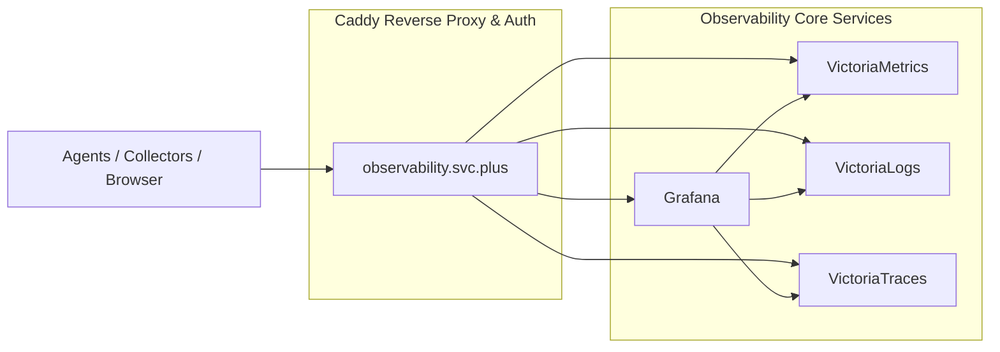

# Observability Server Role (`docker/observability-server`)

部署并托管 **VictoriaMetrics**, **Grafana**, **VictoriaLogs**, **VictoriaTraces**。

> 本角色不再提供 MCP Server，也不在 `observability.svc.plus` 上暴露任何 `/mcp/*` 路由。MCP 统一由 artifacts `oci/charts` 的 `platform-mcp` chart 部署，入口为 `https://mcp.svc.plus`（Bearer `MCP_SERVICE_TOKEN`），与本可观测栈分开部署。

---

## 1. 架构图



---

## 2. 默认端口规划与 Endpoint 统一暴露全清单

### 2.1 可观测性核心服务 Endpoints (标准通用接入点 & 查询)
| 服务组件 | 容器服务名 | 宿主机端口 | Caddy 统一网关 Ingress 路径 (标准 & 兼容) | 核心功能与职责 |
| :--- | :--- | :--- | :--- | :--- |
| **Grafana UI** | `xstream_grafana` | `127.0.0.1:3030` | `https://observability.svc.plus/grafana/` | 统一可视化大盘面板与告警管理 |
| **VictoriaMetrics (Metrics)** | `xstream_victoriametrics` | `127.0.0.1:9090` | OTLP 写入: `/otlp/v1/metrics` (或 `/v1/metrics`)<br>Prom 写入: `/api/v1/write`<br>兼容写入: `/ingest/metrics/*`<br>查询: `/vmetrics/*` | Prometheus 协议指标数据 Remote Write 接收、OTLP/HTTP Metrics 与 MetricsQL 查询 |
| **VictoriaLogs (Logs)** | `xstream_victorialogs` | `127.0.0.1:9428` | OTLP 写入: `/otlp/v1/logs` (或 `/v1/logs`)<br>JSONLine 写入: `/insert/jsonline`<br>兼容写入: `/ingest/logs/*`<br>查询: `/vlogs/*` | OpenTelemetry Logs、JSON Lines 流式写入与 LogsQL 高基数检索 |
| **VictoriaTraces (Traces)** | `xstream_victoriatraces` | `127.0.0.1:10428` | OTLP 写入: `/otlp/v1/traces` (或 `/v1/traces`)<br>兼容写入: `/ingest/otlp/v1/traces`<br>查询: `/vtraces/*` | OpenTelemetry (OTLP/HTTP) 链路接收与 TraceQL 查询 |
| **Blackbox Exporter** | `xstream_blackbox` | `127.0.0.1:9115` | `/blackbox/*` | 网络、域名、HTTP/TCP 探针拨测 |

## 3. 变量列表 (`defaults/main.yml`)

CMDB datasource provisioning is opt-in (`observability_cmdb_enabled: false`).
Before enabling it, configure `observability_cmdb_postgres_host`, verify the
database TLS certificate chain from the observability host, and provision
`CMDB_READER_PASSWORD` at `kv/data/observability/cmdb-grafana`. The role refuses
to enable a real datasource without that secret, the dedicated `cmdb` database,
the `cmdb_reader` identity, and `sslmode=verify-full`. The secret is written to
`cmdb-grafana.env` as a root-owned mode-0600 file and passed only to Grafana at
runtime. The datasource is read-only by database grants; the dashboard panels
query CMDB views. No database is created or migrated by this observability role.

The `CMDB · 多云资源总览` dashboard is installed from the role's dashboard
bundle. The existing homepage dashboard-list panel links to it once provisioned;
the home dashboard is not overwritten.

---

## 4. Secret 配置方式

为了保证凭据安全，敏感 Token **不得明文提交至 Git 仓库**。

配置途径：
1. **Ansible Vault / Group Vars**:
   在 `group_vars/all/vault.yml` 或 `host_vars/<hostname>/vault.yml` 中配置加密变量，不在 Git 中写明文。
2. **HashiCorp Vault**:
   在 Playbook 执行时从 Vault 读取对应 secret 填充至变量中。

Playbook 内部环境模板渲染任务均添加了 `no_log: true` 保护，防止在 CI/CD 日志中泄漏 Token。

---

## 5. 部署与更新命令

### 部署完整 Observability 栈
```bash
ansible-playbook playbooks/deploy_observability.yml
```

---

## 6. 健康检查与验证方法

部署完成后，任务会自动通过 `ansible.builtin.uri` 验证探针。

手动验证命令：
```bash
# 验证 Grafana
curl -i https://observability.svc.plus/api/health
```

---

### Progressive release validation dashboard

The `progressive-release-validation.json` asset is provisioned by the existing
file-discovery task. Select a Prometheus-compatible datasource and one cluster
and environment. The ten endpoint panels and details table use the same
`probe_success` series; missing or stale probes display `NO DATA`. The probe
summary is descriptive and does not control Flagger.

The collector must supply `job="progressive-release-probes"`, `environment`,
`cluster`, `service` (`console`, `accounts`, `billing`) and a bounded `route`
label for each of the ten listed routes. Configure Blackbox modules to accept
the appropriate response, including the unauthenticated login redirect for
`/panel/agent`; never count absent series as success. Probe duration quantiles
are computed from synthetic probe samples, not application request latency.
The Flagger and candidate traffic panels require controller and Traefik metrics
with the labels shown in their queries; until those are scraped they show no
data. Billing has no inferred Canary status.

This asset does not install an exporter, configure targets or modify release
promotion. Verify scrape identity, one series per route, actual response
contracts, no-data handling, and candidate traffic in SIT before production
use. Remove this file from the bundle to roll back its provisioning.
