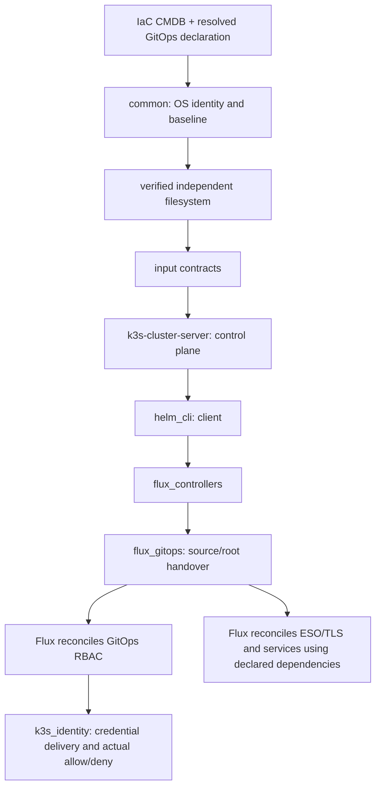

# K3s platform bootstrap

This role defines the initialization dependency order only. It contains no
installer, cluster mutation, credentials, templates or service implementation.
The selected `k3s` hosts and GitOps fields are supplied by the entry playbook;
IaC CMDB remains authoritative for target facts.

| Order | Role | One responsibility | Required dependency / evidence |
| --- | --- | --- | --- |
| Before this role | `vhosts/common` | OS hostname, root/operator/auditor and baseline | Current-node common evidence; no implicit account creation here |
| Before this role | `web_saas_data_volume` | Independent data filesystem | Verified mount UUID when required |
| Preflight | `vhosts/flux_gitops`, `vhosts/k3s_identity` | Validate their own input contracts | Fail before installing software on missing declaration or identity inputs |
| 1 | `vhosts/k3s-cluster-server` | Initialize the control plane | Declared OS hostname, private admin config, mounted storage; API ready |
| 2 | `vhosts/helm_cli` | Prepare the Helm client | Pinned CLI version; no chart deployment |
| 3 | `vhosts/flux_controllers` | Initialize Flux controllers | Ready K3s API; controller rollouts ready |
| 4 | `vhosts/flux_gitops` | Hand reviewed declarations to Flux | Fixed checkout/revision for declarative mode; separate handover receipt |
| 5 | `vhosts/k3s_identity` | Deliver and verify independent Kubernetes identities | Reconciled GitOps RBAC, scoped Vault writer and OS accounts |

ESO, Ingress and application resources belong to GitOps reconciliation. This
role neither deploys their Helm charts nor publishes DNS. Flux handover is not
identity or service acceptance. The role does not implement paused bootstrap.

## Inputs and independent reuse

`k3s_identity_enabled` defaults to true. Missing identity configuration fails;
there is no fallback to the bootstrap admin identity. The component roles own
all other defaults. Existing `k3s_platform_*` and `k3s_identity_*` input names
remain the shared caller contract, without environment-specific aliases.

- [Control plane](../k3s-cluster-server/README.md)
- [Helm CLI](../helm_cli/README.md)
- [Flux controllers](../flux_controllers/README.md)
- [GitOps handover](../flux_gitops/README.md)
- [Kubernetes identities](../k3s_identity/README.md)
- [Three-role design](../k3s_identity/docs/three-role-design.md)
- [Role inventory and migration scope](k3s-role-map.md)

Use `k3s_platform_bootstrap.yml` with `inventory/terraform_cmdb.py` for normal
IaC delivery. `scripts/pipeline/bootstrap-k3s.sh` receives `MATRIX_HOST`,
`K3S_GITOPS_CHECKOUT`, resolved `K3S_GITOPS_SHA`, checkout-relative
`K3S_RESOURCE_MANIFEST`, `K3S_CMDB_SHA256`, and `K3S_BOOTSTRAP_RECEIPT`.
`CMDB_FILE` optionally selects the current IaC output. The caller supplies an
SSH agent and authorized runtime Vault identity. The entry binds cloud facts
and declaration fields, executes common/storage, then calls this coordinator.

The independent `k3s_identity_bootstrap.yml` calls the identity role directly,
without reinstalling the cluster or replaying the GitOps handover.

## Retry, verification and rollback

Each execution role owns its retries and evidence. Failures stop dependent
roles. Do not retry a partial issuance by deleting identity state or Vault
records. Reverting this refactor restores code/caller paths only; it does not
roll back a database, revoke a certificate or remove cluster state. Destructive
recovery, stateful upgrades, storage reformatting and DNS cutover require their
own reviewed operation.

Local contract tests and Ansible syntax/list-task checks verify composition.
No local check demonstrates production RBAC, Vault authorization, idempotency
or application readiness; record those separately after authorized execution.
